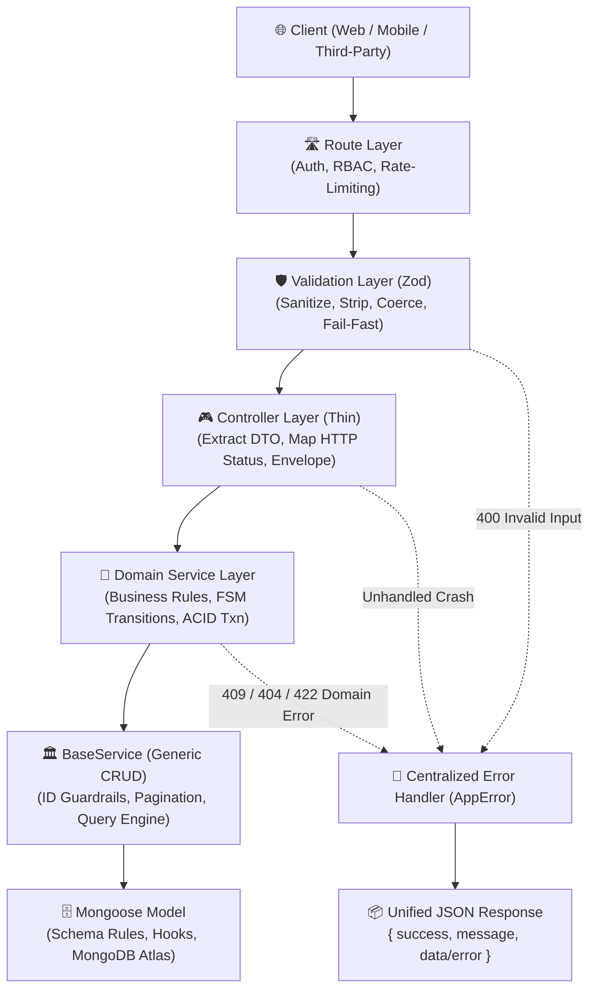

# 🏛️ Production Backend Architecture Standards & Engineering Playbook
> **Battle-tested architectural guidelines, design principles, and production standards for Node.js, Express, MongoDB (Mongoose), and Zod.**

[](https://nodejs.org/)
[](https://www.mongodb.com/)
[](https://zod.dev/)
[](#)
[](#)

---

## 📖 Overview

Building scalable, maintainable, and bug-free enterprise backends requires more than just making code "work". It requires **strict layer boundaries**, **bulletproof schema design**, **unbreakable finite state machines**, and **fail-fast validation contracts**.

This repository is a **7-part comprehensive playbook** designed to guide software engineers through architecting production-grade backend systems from Day 1.

---

## 🗺️ The Complete Architecture Suite

Navigate directly to each standard document:

| # | Standard Document | Focus Area | Key Highlights |
| :-: | :--- | :--- | :--- |
| **01** | [**`BACKEND_DESIGN_STANDARDS.md`**](./BACKEND_DESIGN_STANDARDS.md) | **Database Models & Schemas** | Compound indexing, integer money (paise), anti-`Mixed` rules, timestamps, snapshotting. |
| **02** | [**`CONSTANTS_STANDARDS.md`**](./CONSTANTS_STANDARDS.md) | **Constants, Enums & FSM** | `Object.freeze`, Finite State Machine transition matrices, deterministic system codes. |
| **03** | [**`VALIDATION_LAYER_STANDARDS.md`**](./VALIDATION_LAYER_STANDARDS.md) | **Request Validation (Zod)** | Strip unknown fields, coerce params, cross-field `.refine()`, zero leaking to controllers. |
| **04** | [**`ROUTE_LAYER_STANDARDS.md`**](./ROUTE_LAYER_STANDARDS.md) | **Routing & Middlewares** | Middleware ordering pipeline, rate limiting, RBAC guards, RESTful verb semantics. |
| **05** | [**`CONTROLLER_LAYER_STANDARDS.md`**](./CONTROLLER_LAYER_STANDARDS.md) | **Thin Controller Layer** | Zero business logic, HTTP status mapping, `asyncHandler` envelope, uniform JSON contract. |
| **06** | [**`SERVICE_LAYER_STANDARDS.md`**](./SERVICE_LAYER_STANDARDS.md) | **Business Logic & Services** | Pure domain rules, ACID MongoDB transactions, third-party isolation, zero HTTP leakage. |
| **07** | [**`BASE_SERVICE_STANDARDS.md`**](./BASE_SERVICE_STANDARDS.md) | **Generic Base Service** | DRY CRUD wrapper, CastError guardrails, limit-clamped pagination, soft-delete engine. |

---

## 🔄 End-to-End Request Lifecycle

Every HTTP request traverses through an uncompromised, unidirectional pipeline:



---

## ⚡ Core Engineering Principles Followed

### 1. Zero Floating-Point Currency
* All monetary values are represented strictly in **integer lowest units** (e.g., `paise`, `cents`).
* Eliminates precision loss (`0.1 + 0.2 = 0.30000000000000004`) in billing, refunds, and cart calculations.

### 2. Thin Controllers, Fat Services
* Controllers do not calculate totals, update state, or query the database directly.
* Controllers exist solely to translate **HTTP Transport $\leftrightarrow$ Domain Data Transfer Objects (DTOs)**.

### 3. Strict State Transition Enforcement (FSM)
* Status updates cannot jump arbitrarily (e.g., an order cannot go from `ORDER_PLACED` directly to `DELIVERED`).
* Transition maps (`VALID_TRANSITIONS[currentStatus]`) guard every state modification.

### 4. Fail-Fast Input Guardrails
* Raw client input is never trusted. Queries, params, and bodies are validated with strict Zod schemas.
* Unknown properties are stripped automatically to prevent NoSQL injection and parameter pollution.

### 5. ACID Multi-Document Transactions
* Multi-collection operations (e.g., `Place Order` + `Reserve Stock` + `Clear Cart`) are executed inside MongoDB sessions with automatic rollback on failure.

---

## 📂 Recommended Project Directory Structure

```text
src/
├── config/                  # Environment variables, database connection, redis
├── middlewares/             # Auth, RBAC, RateLimiter, Centralized ErrorHandler
├── routes/                  # Central route aggregator (index.js)
├── shared/                  # Reusable enterprise utilities
│   ├── BaseService.js       # Generic CRUD & Pagination Engine
│   ├── AppError.js          # Standardized operational error class
│   └── asyncWrap.js         # Async error wrapper
└── modules/                 # Modular Domain Architecture
    ├── orders/
    │   ├── orders.constants.js    # FSM, Enums, Reason Codes
    │   ├── orders.model.js        # Mongoose Schema & Indexes
    │   ├── orders.validation.js   # Zod Schemas
    │   ├── orders.service.js      # Core Domain Logic (extends BaseService)
    │   ├── orders.controller.js   # Transport Adapter
    │   └── orders.routes.js       # Route & Middleware Pipeline
    ├── stores/
    ├── cart/
    └── users/
```

---

## 🧪 Quality & Testing Expectations

Every module following this specification must pass the **Triple Verification Guarantee**:

1. **Unit Testing:** Individual validation schemas, FSM transitions, and service methods tested with mocked models.
2. **Integration Testing:** Multi-collection transactions verified with MongoDB in-memory or staging Atlas cluster.
3. **Static Analysis & Linting:** 0 ESLint errors, strict Prettier formatting, clean Git commit conventions.

---

## 🤝 How to Use This Playbook

* **For New Features:** Start from `01 (Model)` $\rightarrow$ `02 (Constants)` $\rightarrow$ `03 (Validation)` $\rightarrow$ `04 (Route)` $\rightarrow$ `05 (Controller)` $\rightarrow$ `06 (Service)` $\rightarrow$ `07 (BaseService)`.
* **For Code Reviews:** Use the checklists inside each document as your **Pull Request (PR) Acceptance Criteria**.
* **For Team Onboarding:** Share this repository with new engineers to align on architectural conventions.

---

## 📄 License
This architecture playbook is open-sourced under the **MIT License**. Feel free to use and adapt it across your commercial and enterprise projects.
